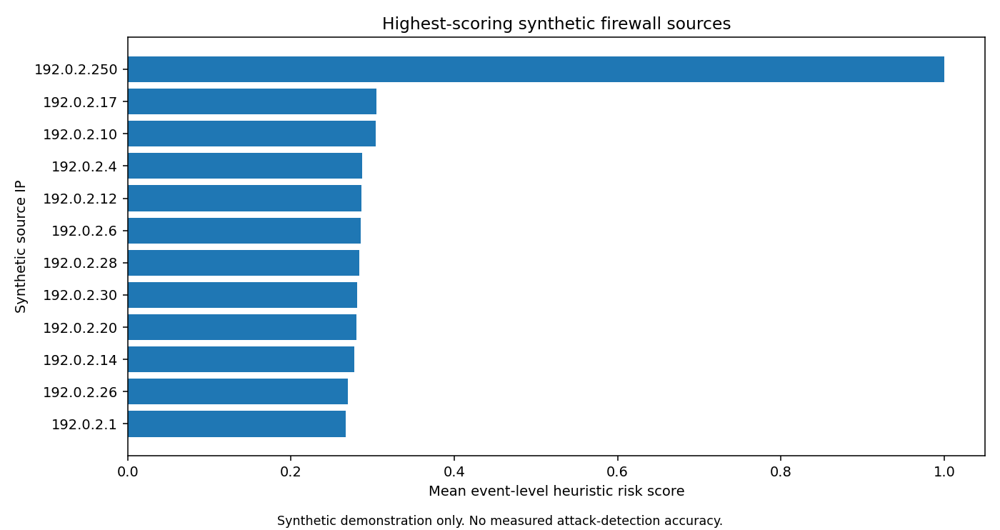

# Network Risk Analyzer

**Isolation Forest | Python | pandas | scikit-learn | Streamlit**

A university machine learning project that explores anomaly detection in firewall, VPN and enpoint logs. It processes network events, looks for statistical outliers with Isolation Forest, and assigns a heuristic risk score to each source IP. The Streamlit app lets you upload a CSV, review the highest-scoring IPs, and export a summary.

**This is a demonstration, not a production intrusion detection system.** An unusual event is not necessarily malicious, and the risk score is not a probability of an attack.



*The chart above uses synthetic data, including deliberately injected unusual events. It does not show detection performance on real traffic.*

## What the project does

1. **Prepare data.** Validate the CSV schema, parse timestamps, convert numeric fields and handle missing numeric values.
2. **Build features.** Derive a sent/received byte ratio, an off-hours score, a received-byte heuristic, a denied-action flag and a high-port flag.
3. **Detect outliers.** Run Isolation Forest on six numeric features. The fitted imputer and scaler are saved with the model.
4. **Score events.** Combine the anomaly flag and five hand-assigned heuristic weights into a score between 0 and 1.
5. **Summarize by IP.** Compute mean event risk, anomaly rate, event count and the first/last observation for each source IP.
6. **Explore results.** View ranked IPs and export a CSV from Streamlit.

## Run it locally

Requires Python 3.10 or later.

```bash
python -m venv .venv
# Linux/macOS: source .venv/bin/activate
# Windows PowerShell: .venv\Scripts\Activate.ps1
pip install -r requirements.txt

# Train a reproducible demo model on the included synthetic CSV.
python train.py --data data/sample_firewall_logs.csv

# Start the interface and select "Use synthetic sample data".
streamlit run app.py
```

The model is saved at `artifacts/model.joblib` and intentionally excluded from Git. You must train before starting the app. For your own CSV, pass its path to `train.py` instead. **Only load model files from trusted sources:** joblib files are based on Python serialization and should never be treated as safe untrusted data.

To run the included checks:

```bash
pip install -r requirements-dev.txt
python -m pytest -q
```

## CSV format

The input must contain these columns:

| Column | Description |
| --- | --- |
| `SOURCE_IP` | Source IP address, used to aggregate events |
| `DATE_TIME` | Timestamp formatted as `YYYY-MM-DD HH:MM:SS` |
| `RCVD_BYTE` | Received byte count |
| `SENT_BYTE` | Sent byte count |
| `DURATION` | Connection duration, as recorded in the dataset |
| `DESTINATION_PORT` | Destination port |
| `ACTION` | Firewall action; the value `deny` sets the deny flag |

The sample file in `data/` is **entirely synthetic**. It uses the reserved `192.0.2.0/24` documentation address space and deliberately includes unusual activity for one fictional IP. No original firewall logs are included.

## Scoring

The original implementation combined several simple signals. This revised version preserves their weights:

| Signal | Weight |
| --- | ---: |
| Time-of-day / weekend heuristic | 0.20 |
| Received-byte heuristic | 0.10 |
| Capped sent/received byte ratio | 0.10 |
| Denied action | 0.10 |
| Destination port >= 1024 | 0.10 |
| Isolation Forest outlier | 0.40 |

An IP's risk is the **mean of its event-level scores**. The exploratory thresholds are *Low* below 0.4, *Medium* from 0.4 up to 0.7, and *High* from 0.7 onward. These choices were not statistically calibrated or validated against attack labels.

The values 50/200/500 for received bytes, the office-hour assumptions, and the treatment of high ports are exploratory rules from the academic project. They should **not** be interpreted as general cybersecurity standards. The README does not claim an accuracy, precision, recall or false-positive rate because the provided materials do not contain ground-truth attack labels.

## Code and repository layout

```text
network-risk-analyzer/
├── README.md
├── risk_pipeline.py              # Feature engineering, fitted ML pipeline, scoring
├── train.py                      # Train and save a model from a CSV
├── app.py                        # Streamlit CSV upload and risk dashboard
├── data/
│   └── sample_firewall_logs.csv  # Synthetic data only
├── scripts/
│   └── generate_sample.py        # Deterministic sample generator
├── notebooks/
│   ├── demo_walkthrough.ipynb    # Runnable example using synthetic data
│   └── legacy/
│       └── original_exploration.ipynb  # Historical notebook, outputs removed
├── tests/
│   └── test_pipeline.py
├── docs/
│   ├── technical_review.md
│   └── figures/
└── requirements.txt
```

## Background and data availability

I developed this project for a university *Machine Learning and Big Data Analysis* course. The original work used a large firewall-log dataset, which is no longer available. Because that dataset was lost, the historical plots and model results cannot be independently reproduced from this repository.

To make the implementation inspectable and runnable, this repository provides a **separate synthetic dataset** and a retrained demonstration model. Results generated from the sample are *not* the original project's findings and do not establish detection accuracy on real networks.

The Isolation Forest setting `contamination=0.05` defines an assumed 5% outlier fraction during fitting. It does **not** mean `p < 0.05`, 95% confidence, or 95% model accuracy. No p-value or statistically validated detection performance is claimed.


See [technical review](docs/technical_review.md) for the original implementation's limitations and the changes made to the runnable version.
